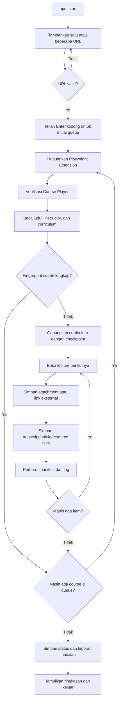

# Udemy Course Text Scraper

Scraper lokal untuk mengekspor transcript video, article, resource teks, attachment, dan link eksternal dari course Udemy ke Markdown.

Automasi menggunakan Chrome yang sudah login, Playwright CLI, dan [Playwright Extension resmi](https://chromewebstore.google.com/detail/playwright-extension/mmlmfjhmonkocbjadbfplnigmagldckm). Scraper tidak memakai CDP port `9222` dan tidak memanggil API LLM. Jika Udemy tidak menyediakan transcript, audio sementara diproses secara lokal lalu dihapus.

> Gunakan hanya untuk course yang dapat Anda akses dan konten yang diizinkan untuk diekspor. Jangan mempublikasikan hasil course tanpa izin pemiliknya.

## Fitur

- Transcript video, article, dan resource teks disimpan sebagai Markdown.
- Transcript beraksara Arab otomatis dialihkan ke caption English Udemy sebelum disimpan.
- Video tanpa transcript Udemy diproses otomatis menggunakan Whisper lokal dalam bahasa Inggris.
- Banyak attachment dalam satu lecture dapat diunduh.
- Link eksternal disimpan terpisah dalam `00_EXTERNAL_RESOURCES.md`.
- Struktur output mengikuti course, section, dan lecture.
- Beberapa URL dapat dimasukkan ke queue dan diproses berurutan.
- Queue disimpan ke `logs/queue-state.json` dan dilanjutkan otomatis setelah proses terputus.
- Course bermasalah dicatat lalu dilewati agar course berikutnya tetap berjalan.
- Mendukung course dengan lebih dari satu instructor.
- Fingerprint mencegah pemrosesan ulang course yang sudah lengkap.
- Checkpoint memungkinkan proses dilanjutkan setelah terputus.
- Resource dari manifest versi lama dipindai ulang tanpa mengulang transcript yang masih lengkap.
- Retry dan log dijalankan otomatis tanpa pengawasan LLM.

## Alur kerja



## Persyaratan

- Windows 10/11 dan PowerShell 5.1 atau lebih baru.
- Node.js 22 LTS direkomendasikan.
- Google Chrome.
- Akun Udemy yang mempunyai akses ke course.
- [Playwright Extension resmi di Chrome Web Store](https://chromewebstore.google.com/detail/playwright-extension/mmlmfjhmonkocbjadbfplnigmagldckm).
- Python 3.9 atau lebih baru dan FFmpeg untuk fallback Whisper lokal.

## Instalasi

```powershell
git clone https://github.com/myfirnanda/scrap-udemy.git
cd scrap-udemy
npm install
Copy-Item .env.example .env
```

Repository GitHub bersifat private, jadi akun GitHub yang melakukan clone harus mempunyai akses.

### Pasang extension dan ambil token

1. Klik **[Playwright Extension di Chrome Web Store](https://chromewebstore.google.com/detail/playwright-extension/mmlmfjhmonkocbjadbfplnigmagldckm)**.
2. Klik **Add to Chrome**, lalu selesaikan pemasangan.
3. Klik ikon **Extensions** berbentuk puzzle pada toolbar Chrome.
4. Buka **Playwright Extension** dan salin nilai `PLAYWRIGHT_MCP_EXTENSION_TOKEN` yang ditampilkan.
5. Tempel nilainya ke file `.env`:

   ```dotenv
   PLAYWRIGHT_MCP_EXTENSION_TOKEN=tempel-token-di-sini
   PLAYWRIGHT_MCP_PROFILE_DIR_NAME=Default
   ```

Token menghubungkan Playwright CLI ke extension tanpa dialog **Allow & select** pada setiap koneksi normal. Jangan commit atau membagikan token tersebut.
`PLAYWRIGHT_MCP_PROFILE_DIR_NAME` adalah nama profil dari `chrome://version`, bukan path folder. Nilai Chrome standar biasanya `Default`.

## Penggunaan

Jalankan:

```powershell
npm start
```

Tambahkan URL satu per satu. Setelah seluruh URL masuk, tekan **Enter** pada input kosong untuk mulai:

```text
URL course #1 (kosong = mulai): https://www.udemy.com/course/course-pertama/
Ditambahkan. Total queue: 1
URL course #2 (kosong = mulai): https://www.udemy.com/course/course-kedua/
Ditambahkan. Total queue: 2
URL course #3 (kosong = mulai):
```

Pada baris terakhir contoh di atas, langsung tekan **Enter** tanpa mengetik apa pun. Jika terminal masih menampilkan `URL course #8 (kosong = mulai):`, berarti tujuh URL sudah masuk ke queue, tetapi pemrosesan belum dimulai karena runner masih menunggu Enter kosong.

Setelah queue dimulai, progress tampil langsung di terminal:

```text
=== Course 1/7 ===
=== Pass 1/3 ===
```

`Course 1/7` berarti scraper sedang mengerjakan course pertama dari tujuh course. Terminal juga menampilkan section dan lecture aktif. Setelah satu course selesai, runner otomatis melanjutkan ke `Course 2/7` sampai queue habis, kemudian proses terminal berhenti sendiri.

Saat video ditranskrip, terminal menampilkan progress per batch:

```text
Transcript [##########----------] ~50% | ~9:44/19:29 | 271 cue | batch 3 | 0:28
Transcript [####################] 100% | 271 cue | tersimpan
```

Progress diperbarui pada satu baris terminal yang sama agar output tidak memenuhi layar. Persentase bertanda `~` adalah estimasi posisi panel transcript terhadap durasi video. Nilainya dapat diam sementara ketika Udemy menambah tinggi panel secara dinamis; nomor batch, jumlah cue, dan waktu berjalan tetap menunjukkan proses masih aktif. Angka `100%` hanya ditampilkan setelah Markdown berhasil disimpan.

Jika transcript Udemy tetap tidak tersedia setelah tiga pemeriksaan, scraper memakai Whisper lokal. Audio diproses pada kecepatan asli agar akurat; inferensi berjalan secepat kemampuan CPU tanpa memutar video sampai selesai. Model `base` sekitar 150 MB diunduh satu kali dan disimpan dalam `.whisper-models/`. Audio sementara dihapus setelah Markdown tersimpan. Sumber transcript dicatat sebagai `whisper-local` dalam `course_manifest.json`.

Queue diproses secara berurutan agar transcript dan resource tidak tertukar. Setelah course pertama selesai, scraper otomatis membuka course kedua pada tab Course Player yang sama. URL duplikat tidak ditambahkan dua kali.

Jika satu course belum tuntas atau mengalami security challenge, checkpoint dan detail masalahnya disimpan lalu scraper melanjutkan course berikutnya. Token extension yang tidak tersedia tetap menghentikan runner karena semua course membutuhkan koneksi tersebut.

Queue aktif tersimpan dalam `logs/queue-state.json`. Jika terminal atau Chrome terputus, jalankan `npm start` kembali; queue yang belum selesai dilanjutkan otomatis tanpa memasukkan ulang URL. Course bermasalah dirangkum dalam `logs/problem-courses.json` beserta status, alasan, dan lokasi log terakhir.

Format yang diterima:

```text
https://www.udemy.com/course/<slug>/
https://www.udemy.com/course/<slug>/learn/
https://www.udemy.com/course/<slug>/learn/lecture/<id>
```

URL harus memakai `https://www.udemy.com/course/...`. Setelah seluruh queue selesai atau sudah dicatat sebagai bermasalah, terminal berhenti sendiri.

Chrome utama dan tab lain tidak ditutup. Popup yang dibuat oleh resource eksternal dapat ditutup setelah URL-nya dicatat.

### Command

| Command | Kegunaan |
| --- | --- |
| `npm install` | Dijalankan sekali saat pertama menyiapkan project. |
| `npm start` | Menjalankan seluruh workflow scraper. |

## Struktur output

```text
output/
└── <judul_course>_<owner_1_&_owner_2>/
    ├── course_manifest.json
    ├── scraping_log.json
    ├── _debug/
    ├── 1_<nama_section>/
    │   ├── 1_<judul_lecture>.md
    │   └── 2_<judul_lecture>_resources/
    │       ├── 00_EXTERNAL_RESOURCES.md
    │       ├── 01_source-code.zip
    │       └── 02_dataset.csv
    └── 2_<nama_section>/
        └── 1_<judul_lecture>.md
```

- Transcript, article, dan resource teks memakai file `<nomor>_<lecture>.md`.
- Link eksternal dari menu Resources disimpan dalam `00_EXTERNAL_RESOURCES.md`.
- File attachment diberi nomor `01_...`, `02_...`, dan seterusnya.
- Resource selalu berada di dalam section dan folder lecture pemiliknya.
- `course_manifest.json` menyimpan fingerprint, status, metadata transcript, lokasi file, dan checkpoint.
- `_debug/` menyimpan screenshot dan HTML ketika lecture gagal.
- `logs/` pada root project menyimpan output setiap course dan pass dalam queue.

## Checkpoint, resume, dan fingerprint

Jika terminal, Chrome, jaringan, atau extension terputus, jalankan `npm start` kembali. Queue dan checkpoint course yang belum selesai digunakan otomatis.

Saat resume, scraper akan:

- Melewati transcript dan attachment yang file-nya masih lengkap.
- Mengulang item `pending`, `failed`, hilang, atau kosong.
- Mengulang timeout transcript, navigasi, dan download; kondisi tersebut tidak dianggap `skipped` permanen.
- Memindai ulang resource dari manifest lama yang belum mempunyai jenis resource.
- Mempertahankan hasil lecture lama ketika curriculum masih cocok.

Fingerprint merupakan SHA-256 dari judul course dan seluruh instructor. Pesan berikut hanya muncul jika semua lecture dan resource sudah mencapai status akhir dan file wajib masih tersedia:

```text
Course sudah pernah ditranskrip: "Judul Course" oleh Nama Instructor.
```

Saat URL dijalankan kembali, curriculum terbaru dibandingkan dengan manifest. Lecture atau resource baru diproses tanpa mengulang file lama yang masih lengkap.

## Kelebihan dan keterbatasan

### Kelebihan

- Menggunakan sesi login Chrome yang sudah ada.
- Tidak memakai token atau API transkripsi berbayar.
- Resume tersedia pada level lecture dan attachment.
- Mendukung banyak instructor dan banyak resource.
- Output Markdown mudah dicari dan dibaca.

### Keterbatasan

- Workflow utama dibuat untuk Windows/PowerShell.
- Bergantung pada struktur DOM Udemy yang dapat berubah.
- Whisper lokal menggunakan CPU sehingga lebih lambat daripada transcript bawaan Udemy dan dapat salah mengenali istilah teknis.
- Caption Arab tanpa pilihan English diterjemahkan ke English oleh Whisper lokal.
- Transcript tidak menyertakan timestamp atau speaker.
- Video dan audio tidak disimpan sebagai output. Latihan Coding diekspor sebagai Markdown berisi petunjuk, hint, dan starter file/TODO; solution dan evaluation test tidak disimpan. Quiz biasa dan Role Play tidak diekspor.
- Pemrosesan masih berurutan, belum paralel.

## Troubleshooting

| Masalah | Tindakan |
| --- | --- |
| Extension tidak ditemukan | Pasang extension melalui link Chrome Web Store di bagian instalasi. |
| Token tidak tersedia | Isi `PLAYWRIGHT_MCP_EXTENSION_TOKEN` pada `.env`. |
| Koneksi timeout | Buka extension, salin ulang token, perbarui `.env`, lalu jalankan ulang. |
| Belum login | Login ke Udemy di Chrome lalu jalankan ulang. |
| Proses terputus | Jalankan `npm start`; queue tersimpan dilanjutkan otomatis dan manifest jangan dihapus. |
| Satu course bermasalah | Course tersebut dilewati; lihat alasan dan log pada `logs/problem-courses.json`. |
| Existing course belum memiliki resource | Jalankan ulang URL yang sama; resource lama akan dimigrasikan. |
| Sudah memasukkan URL tetapi belum berjalan | Pada prompt URL berikutnya, tekan Enter tanpa mengetik apa pun untuk memulai queue. |
| Ingin melihat progress queue | Lihat terminal runner: `Course X/Y` menunjukkan posisi course dan baris berikutnya menunjukkan pass, section, serta lecture aktif. |
| Proses belum selesai | Periksa terminal, `logs/`, `scraping_log.json`, manifest, dan folder `_debug/`. |
| CAPTCHA/security challenge | Selesaikan secara manual di Chrome lalu jalankan ulang. |
