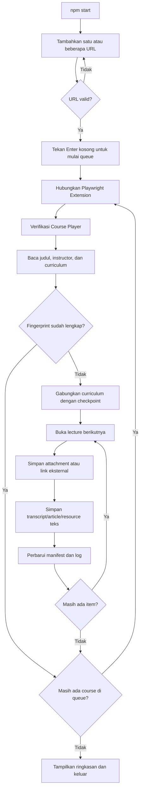

# Udemy Course Text Scraper

Scraper lokal untuk mengekspor transcript video, article, resource teks, attachment, dan link eksternal dari course Udemy ke Markdown.

Automasi menggunakan Chrome yang sudah login, Playwright CLI, dan [Playwright Extension resmi](https://chromewebstore.google.com/detail/playwright-extension/mmlmfjhmonkocbjadbfplnigmagldckm). Scraper tidak memakai CDP port `9222`, tidak mengunduh video/audio, dan tidak memanggil API LLM.

> Gunakan hanya untuk course yang dapat Anda akses dan konten yang diizinkan untuk diekspor. Jangan mempublikasikan hasil course tanpa izin pemiliknya.

## Fitur

- Transcript video, article, dan resource teks disimpan sebagai Markdown.
- Banyak attachment dalam satu lecture dapat diunduh.
- Link eksternal disimpan terpisah dalam `00_EXTERNAL_RESOURCES.md`.
- Struktur output mengikuti course, section, dan lecture.
- Beberapa URL dapat dimasukkan ke queue dan diproses berurutan.
- Mendukung course dengan lebih dari satu instructor.
- Fingerprint mencegah pemrosesan ulang course yang sudah lengkap.
- Checkpoint memungkinkan proses dilanjutkan setelah terputus.
- Resource dari manifest versi lama dipindai ulang tanpa mengulang transcript yang masih lengkap.
- Retry dan log dijalankan otomatis tanpa pengawasan LLM.

## Alur kerja



## Persyaratan

- Windows 10/11 dan PowerShell 5.1 atau lebih baru.
- Node.js 22 LTS direkomendasikan.
- Google Chrome.
- Akun Udemy yang mempunyai akses ke course.
- [Playwright Extension resmi di Chrome Web Store](https://chromewebstore.google.com/detail/playwright-extension/mmlmfjhmonkocbjadbfplnigmagldckm).

## Instalasi

```powershell
git clone https://github.com/myfirnanda/scrap-udemy.git
cd scrap-udemy
npm install
Copy-Item .env.example .env
```

Repository GitHub bersifat private, jadi akun GitHub yang melakukan clone harus mempunyai akses.

### Pasang extension dan ambil token

1. Klik **[Playwright Extension di Chrome Web Store](https://chromewebstore.google.com/detail/playwright-extension/mmlmfjhmonkocbjadbfplnigmagldckm)**.
2. Klik **Add to Chrome**, lalu selesaikan pemasangan.
3. Klik ikon **Extensions** berbentuk puzzle pada toolbar Chrome.
4. Buka **Playwright Extension** dan salin nilai `PLAYWRIGHT_MCP_EXTENSION_TOKEN` yang ditampilkan.
5. Tempel nilainya ke file `.env`:

   ```dotenv
   PLAYWRIGHT_MCP_EXTENSION_TOKEN=tempel-token-di-sini
   ```

Token menghubungkan Playwright CLI ke extension tanpa dialog **Allow & select** pada setiap koneksi normal. Jangan commit atau membagikan token tersebut.

## Penggunaan

Jalankan:

```powershell
npm start
```

Tambahkan URL satu per satu. Setelah seluruh URL masuk, tekan **Enter** pada input kosong untuk mulai:

```text
URL course #1 (kosong = mulai): https://www.udemy.com/course/course-pertama/
Ditambahkan. Total queue: 1
URL course #2 (kosong = mulai): https://www.udemy.com/course/course-kedua/
Ditambahkan. Total queue: 2
URL course #3 (kosong = mulai):
```

Queue diproses secara berurutan agar transcript dan resource tidak tertukar. Setelah course pertama selesai, scraper otomatis membuka course kedua pada tab Course Player yang sama. URL duplikat tidak ditambahkan dua kali.

Jika satu course belum tuntas setelah seluruh percobaan, checkpoint-nya tetap tersimpan dan scraper melanjutkan course berikutnya. CAPTCHA atau token extension yang tidak tersedia akan menghentikan seluruh queue karena keduanya memerlukan tindakan pengguna.

Format yang diterima:

```text
https://www.udemy.com/course/<slug>/
https://www.udemy.com/course/<slug>/learn/
https://www.udemy.com/course/<slug>/learn/lecture/<id>
```

URL harus memakai `https://www.udemy.com/course/...`. Setelah proses selesai atau gagal, terminal berhenti sendiri.

Chrome utama dan tab lain tidak ditutup. Popup yang dibuat oleh resource eksternal dapat ditutup setelah URL-nya dicatat.

### Command

| Command | Kegunaan |
| --- | --- |
| `npm install` | Dijalankan sekali saat pertama menyiapkan project. |
| `npm start` | Menjalankan seluruh workflow scraper. |

## Struktur output

```text
output/
└── <judul_course>_<owner_1_&_owner_2>/
    ├── course_manifest.json
    ├── scraping_log.json
    ├── _debug/
    ├── 1_<nama_section>/
    │   ├── 1_<judul_lecture>.md
    │   └── 2_<judul_lecture>_resources/
    │       ├── 00_EXTERNAL_RESOURCES.md
    │       ├── 01_source-code.zip
    │       └── 02_dataset.csv
    └── 2_<nama_section>/
        └── 1_<judul_lecture>.md
```

- Transcript, article, dan resource teks memakai file `<nomor>_<lecture>.md`.
- Link eksternal dari menu Resources disimpan dalam `00_EXTERNAL_RESOURCES.md`.
- File attachment diberi nomor `01_...`, `02_...`, dan seterusnya.
- Resource selalu berada di dalam section dan folder lecture pemiliknya.
- `course_manifest.json` menyimpan fingerprint, status, lokasi file, dan checkpoint.
- `_debug/` menyimpan screenshot dan HTML ketika lecture gagal.
- `logs/` pada root project menyimpan output setiap course dan pass dalam queue.

## Checkpoint, resume, dan fingerprint

Jika terminal, Chrome, jaringan, atau extension terputus, jalankan `npm start` kembali dan masukkan kembali URL course yang belum selesai. Checkpoint course tetap digunakan.

Saat resume, scraper akan:

- Melewati transcript dan attachment yang file-nya masih lengkap.
- Mengulang item `pending`, `failed`, hilang, atau kosong.
- Memindai ulang resource dari manifest lama yang belum mempunyai jenis resource.
- Mempertahankan hasil lecture lama ketika curriculum masih cocok.

Fingerprint merupakan SHA-256 dari judul course dan seluruh instructor. Pesan berikut hanya muncul jika semua lecture dan resource sudah mencapai status akhir dan file wajib masih tersedia:

```text
Course sudah pernah ditranskrip: "Judul Course" oleh Nama Instructor.
```

Course yang sudah dinyatakan lengkap belum diperiksa otomatis untuk materi baru yang ditambahkan Udemy setelahnya. Untuk melakukan pengambilan ulang penuh, pindahkan folder course lama keluar dari `output/` sebagai backup lalu jalankan kembali.

## Kelebihan dan keterbatasan

### Kelebihan

- Menggunakan sesi login Chrome yang sudah ada.
- Tidak memakai token atau API LLM.
- Resume tersedia pada level lecture dan attachment.
- Mendukung banyak instructor dan banyak resource.
- Output Markdown mudah dicari dan dibaca.

### Keterbatasan

- Workflow utama dibuat untuk Windows/PowerShell.
- Bergantung pada struktur DOM Udemy yang dapat berubah.
- Transcript hanya tersedia jika disediakan oleh Udemy.
- Transcript tidak menyertakan timestamp atau speaker.
- Video, audio, quiz, dan exercise interaktif tidak diekspor.
- Pemrosesan masih berurutan, belum paralel.
- Course yang sudah lengkap belum mempunyai mode refresh otomatis.

## Troubleshooting

| Masalah | Tindakan |
| --- | --- |
| Extension tidak ditemukan | Pasang extension melalui link Chrome Web Store di bagian instalasi. |
| Token tidak tersedia | Isi `PLAYWRIGHT_MCP_EXTENSION_TOKEN` pada `.env`. |
| Koneksi timeout | Buka extension, salin ulang token, perbarui `.env`, lalu jalankan ulang. |
| Belum login | Login ke Udemy di Chrome lalu jalankan ulang. |
| Proses terputus | Jalankan `npm start` dengan URL yang sama; jangan hapus manifest. |
| Existing course belum memiliki resource | Jalankan ulang URL yang sama; resource lama akan dimigrasikan. |
| Proses belum selesai | Periksa `logs/`, `scraping_log.json`, manifest, dan folder `_debug/`. |
| CAPTCHA/security challenge | Selesaikan secara manual di Chrome lalu jalankan ulang. |
