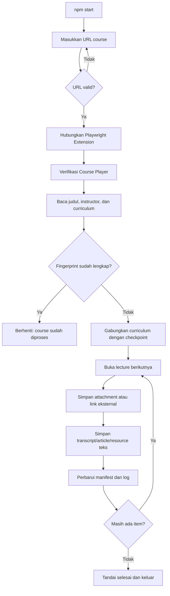

# Udemy Course Text Scraper

Scraper lokal untuk mengekspor transcript video, article, resource teks, attachment, dan link eksternal dari course Udemy ke Markdown.

Automasi menggunakan Chrome yang sudah login, Playwright CLI, dan [Playwright Extension resmi](https://chromewebstore.google.com/detail/playwright-extension/mmlmfjhmonkocbjadbfplnigmagldckm). Scraper tidak memakai CDP port `9222`, tidak mengunduh video/audio, dan tidak memanggil API LLM.

> Gunakan hanya untuk course yang dapat Anda akses dan konten yang diizinkan untuk diekspor. Jangan mempublikasikan hasil course tanpa izin pemiliknya.

## Fitur

- Transcript video, article, dan resource teks disimpan sebagai Markdown.
- Banyak attachment dalam satu lecture dapat diunduh.
- Link eksternal disimpan terpisah dalam `00_EXTERNAL_RESOURCES.md`.
- Struktur output mengikuti course, section, dan lecture.
- Mendukung course dengan lebih dari satu instructor.
- Fingerprint mencegah pemrosesan ulang course yang sudah lengkap.
- Checkpoint memungkinkan proses dilanjutkan setelah terputus.
- Resource dari manifest versi lama dipindai ulang tanpa mengulang transcript yang masih lengkap.
- Retry dan log dijalankan otomatis tanpa pengawasan LLM.

## Alur kerja



## Persyaratan

- Windows 10/11 dan PowerShell 5.1 atau lebih baru.
- Node.js 22 LTS direkomendasikan.
- Google Chrome.
- Akun Udemy yang mempunyai akses ke course.
- [Playwright Extension resmi](https://chromewebstore.google.com/detail/playwright-extension/mmlmfjhmonkocbjadbfplnigmagldckm), extension ID `mmlmfjhmonkocbjadbfplnigmagldckm`.

## Instalasi

```powershell
git clone https://github.com/myfirnanda/scrap-udemy.git
cd scrap-udemy
npm install
Copy-Item .env.example .env
```

Repository GitHub bersifat private, jadi akun GitHub yang melakukan clone harus mempunyai akses.

### Mendapatkan token Playwright Extension

1. Buka Chrome menggunakan profil yang menyimpan login Udemy.
2. Pasang Playwright Extension resmi pada profil tersebut.
3. Klik ikon **Extensions** berbentuk puzzle pada toolbar Chrome.
4. Buka **Playwright Extension**.
5. Salin nilai `PLAYWRIGHT_MCP_EXTENSION_TOKEN` yang ditampilkan oleh extension.
6. Tempel nilainya ke `.env`:

   ```dotenv
   PLAYWRIGHT_MCP_EXTENSION_TOKEN=tempel-token-di-sini
   PLAYWRIGHT_MCP_PROFILE_DIR_NAME=Default
   ```

Token bersifat khusus untuk profil Chrome. Untuk memastikan nama profil:

1. Buka `chrome://version`.
2. Cari **Profile Path**.
3. Gunakan nama direktori paling akhir, misalnya `Default`, `Profile 1`, atau `Profile 2`.

Contoh jika Profile Path berakhir dengan `Profile 2`:

```dotenv
PLAYWRIGHT_MCP_PROFILE_DIR_NAME=Profile 2
```

Verifikasi `.env` tanpa menampilkan isi token:

```powershell
node -e "process.loadEnvFile('.env'); console.log({ tokenConfigured: Boolean(process.env.PLAYWRIGHT_MCP_EXTENSION_TOKEN), profile: process.env.PLAYWRIGHT_MCP_PROFILE_DIR_NAME })"
```

Token menghubungkan Playwright CLI ke extension tanpa dialog **Allow & select** pada setiap koneksi normal. Jangan commit atau membagikan token tersebut.

## Konfigurasi

| Variabel | Default | Kegunaan |
| --- | --- | --- |
| `PLAYWRIGHT_MCP_EXTENSION_TOKEN` | Wajib | Token dari UI Playwright Extension. |
| `PLAYWRIGHT_MCP_PROFILE_DIR_NAME` | Deteksi otomatis | Nama direktori profil Chrome, misalnya `Default`. |
| `OUTPUT_DIR` | `output` | Folder utama hasil scraping. |
| `MAX_LECTURE_ATTEMPTS` | `3` | Percobaan per lecture, nilai `1` sampai `10`. |

Jumlah pass keseluruhan defaultnya tiga. Untuk mengubahnya pada terminal saat ini:

```powershell
$env:AUTO_PASSES = '5'
npm start
```

## Penggunaan

Jalankan:

```powershell
npm start
```

Masukkan URL ketika terminal meminta:

```text
Masukkan URL course Udemy: https://www.udemy.com/course/course-slug/
```

Format yang diterima:

```text
https://www.udemy.com/course/<slug>/
https://www.udemy.com/course/<slug>/learn/
https://www.udemy.com/course/<slug>/learn/lecture/<id>
```

URL harus memakai `https://www.udemy.com/course/...`. Setelah proses selesai atau batas retry tercapai, terminal berhenti sendiri.

Chrome utama dan tab lain tidak ditutup. Popup yang dibuat oleh resource eksternal dapat ditutup setelah URL-nya dicatat.

### Command

| Command | Kegunaan |
| --- | --- |
| `npm install` | Memasang dependency. |
| `npm start` | Menjalankan seluruh workflow scraper. |
| `npm run check` | Memeriksa TypeScript setelah source diubah. |

## Struktur output

```text
output/
└── <judul_course>_<owner_1_&_owner_2>/
    ├── course_manifest.json
    ├── scraping_log.json
    ├── _debug/
    ├── 1_<nama_section>/
    │   ├── 1_<judul_lecture>.md
    │   └── 2_<judul_lecture>_resources/
    │       ├── 00_EXTERNAL_RESOURCES.md
    │       ├── 01_source-code.zip
    │       └── 02_dataset.csv
    └── 2_<nama_section>/
        └── 1_<judul_lecture>.md
```

- Transcript, article, dan resource teks memakai file `<nomor>_<lecture>.md`.
- Link eksternal dari menu Resources disimpan dalam `00_EXTERNAL_RESOURCES.md`.
- File attachment diberi nomor `01_...`, `02_...`, dan seterusnya.
- Resource selalu berada di dalam section dan folder lecture pemiliknya.
- `course_manifest.json` menyimpan fingerprint, status, lokasi file, dan checkpoint.
- `_debug/` menyimpan screenshot dan HTML ketika lecture gagal.
- `logs/` pada root project menyimpan output setiap auto pass.

## Checkpoint, resume, dan fingerprint

Jika terminal, Chrome, jaringan, atau extension terputus, jalankan `npm start` kembali dan masukkan URL yang sama.

Saat resume, scraper akan:

- Melewati transcript dan attachment yang file-nya masih lengkap.
- Mengulang item `pending`, `failed`, hilang, atau kosong.
- Memindai ulang resource dari manifest lama yang belum mempunyai jenis resource.
- Mempertahankan hasil lecture lama ketika curriculum masih cocok.

Fingerprint merupakan SHA-256 dari judul course dan seluruh instructor. Pesan berikut hanya muncul jika semua lecture dan resource sudah mencapai status akhir dan file wajib masih tersedia:

```text
Course sudah pernah ditranskrip: "Judul Course" oleh Nama Instructor.
```

Course yang sudah dinyatakan lengkap belum diperiksa otomatis untuk materi baru yang ditambahkan Udemy setelahnya. Untuk melakukan pengambilan ulang penuh, pindahkan folder course lama keluar dari `output/` sebagai backup lalu jalankan kembali.

## Status dan exit code

| Status | Arti |
| --- | --- |
| `completed` | Konten berhasil disimpan. |
| `pending` | Belum diproses. |
| `failed` | Gagal dan dapat dicoba lagi. |
| `skipped` | Tidak didukung atau tidak tersedia; dianggap status akhir. |

| Exit code | Arti |
| ---: | --- |
| `0` | Selesai atau course sudah lengkap. |
| `1` | Input atau proses awal gagal. |
| `2` | Masih ada item belum selesai setelah semua pass. |
| `3` | CAPTCHA/security challenge terdeteksi. |
| `4` | Token extension belum dikonfigurasi. |

## Kelebihan dan keterbatasan

### Kelebihan

- Tidak memakai CDP atau profil browser sementara.
- Menggunakan sesi login Chrome yang sudah ada.
- Tidak memakai token atau API LLM.
- Resume tersedia pada level lecture dan attachment.
- Mendukung banyak instructor dan banyak resource.
- Output Markdown mudah dicari dan dibaca.

### Keterbatasan

- Workflow utama dibuat untuk Windows/PowerShell.
- Bergantung pada struktur DOM Udemy yang dapat berubah.
- Transcript hanya tersedia jika disediakan oleh Udemy.
- Transcript tidak menyertakan timestamp atau speaker.
- Video, audio, quiz, dan exercise interaktif tidak diekspor.
- Pemrosesan masih berurutan, belum paralel.
- Course yang sudah lengkap belum mempunyai mode refresh otomatis.

## Troubleshooting

| Masalah | Tindakan |
| --- | --- |
| Extension tidak ditemukan | Pastikan extension resmi terpasang dan aktif pada profil yang benar. |
| Token tidak tersedia | Isi `PLAYWRIGHT_MCP_EXTENSION_TOKEN` pada `.env`. |
| Koneksi timeout | Pastikan token dan `PLAYWRIGHT_MCP_PROFILE_DIR_NAME` berasal dari profil yang sama. |
| Belum login | Login ke Udemy pada profil Chrome tersebut lalu jalankan ulang. |
| Proses terputus | Jalankan `npm start` dengan URL yang sama; jangan hapus manifest. |
| Existing course belum memiliki resource | Jalankan ulang URL yang sama; resource lama akan dimigrasikan. |
| Exit code `2` | Periksa `logs/`, `scraping_log.json`, manifest, dan folder `_debug/`. |
| CAPTCHA/security challenge | Selesaikan secara manual di Chrome lalu jalankan ulang. |

## Keamanan

`.gitignore` mengecualikan data berikut dari Git:

```text
.env
output/
logs/
node_modules/
.playwright-cli/
.chrome-profile/
```

Sebelum push, periksa:

```powershell
git status
git check-ignore .env output logs
```

Jangan commit token extension, cookie/profil Chrome, output course, attachment, atau screenshot debug yang memuat informasi pribadi.
