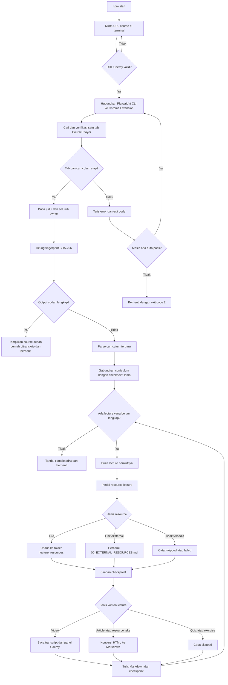
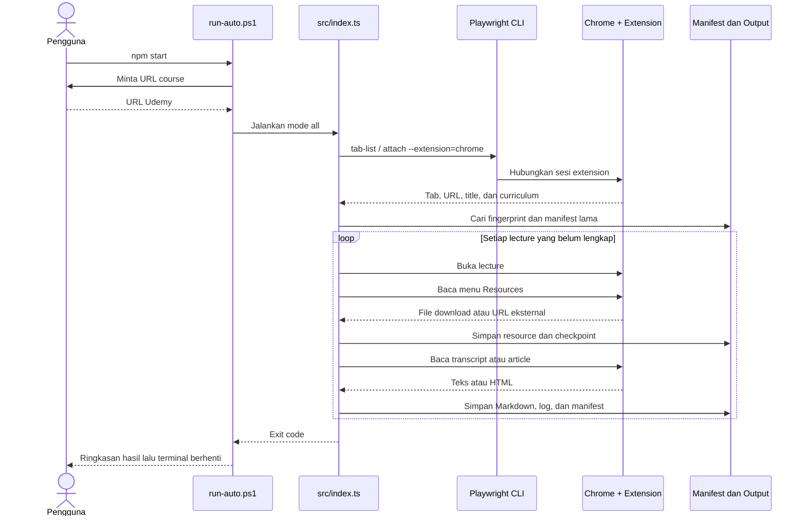

# Udemy Course Text Scraper

Scraper lokal berbasis TypeScript untuk mengekspor transcript video, article, resource teks, file attachment, dan link eksternal dari course Udemy yang dapat diakses oleh akun pengguna.

Automasi memakai **Google Chrome**, sesi login yang sudah ada, **Playwright CLI**, dan **Playwright Extension resmi**. Proses ekstraksi berjalan dengan pembacaan DOM deterministik dan tidak memanggil API LLM. Token extension yang dipakai untuk koneksi browser juga tidak berhubungan dengan token pemakaian model AI.

> Gunakan hanya untuk course yang memang Anda miliki aksesnya dan konten yang diizinkan untuk diekspor. Hormati hak cipta instruktur serta ketentuan penggunaan Udemy. Jangan mempublikasikan hasil course tanpa izin.

## Daftar isi

- [Fitur utama](#fitur-utama)
- [Cara kerja](#cara-kerja)
- [Arsitektur](#arsitektur)
- [Persyaratan](#persyaratan)
- [Instalasi](#instalasi)
- [Mendapatkan token Playwright Extension](#mendapatkan-token-playwright-extension)
- [Konfigurasi](#konfigurasi)
- [Cara menggunakan](#cara-menggunakan)
- [Format URL](#format-url)
- [Struktur output](#struktur-output)
- [Checkpoint dan resume](#checkpoint-dan-resume)
- [Fingerprint dan duplikasi](#fingerprint-dan-duplikasi)
- [Status dan exit code](#status-dan-exit-code)
- [Kelebihan](#kelebihan)
- [Keterbatasan](#keterbatasan)
- [Troubleshooting](#troubleshooting)
- [Keamanan repository](#keamanan-repository)
- [Struktur source code](#struktur-source-code)
- [Pengembangan](#pengembangan)
- [Lisensi](#lisensi)

## Fitur utama

- Menghubungkan automasi ke Chrome melalui Playwright Extension resmi.
- Memakai sesi login dan cookie dari profil Chrome yang dipilih.
- Menggunakan `PLAYWRIGHT_MCP_EXTENSION_TOKEN` agar koneksi normal tidak memerlukan **Allow & select** setiap kali dijalankan.
- Memvalidasi URL course yang dimasukkan langsung melalui terminal.
- Membaca section, lecture, judul course, dan seluruh instructor/owner.
- Mengekspor transcript video yang disediakan Udemy ke Markdown.
- Mengubah article dan resource teks dari HTML menjadi Markdown.
- Mengunduh lebih dari satu attachment pada lecture yang sama.
- Menyimpan link eksternal ke `00_EXTERNAL_RESOURCES.md` agar jelas terpisah dari transcript.
- Menempatkan setiap resource di section dan lecture pemiliknya.
- Menyimpan checkpoint setelah penemuan resource, setiap attachment, dan setiap lecture.
- Melanjutkan proses setelah terminal, Chrome, jaringan, atau koneksi extension terputus.
- Mendeteksi course berdasarkan fingerprint judul dan seluruh owner.
- Mempertahankan hasil lengkap dan memproses ulang data yang hilang atau belum selesai.
- Menyimpan screenshot dan potongan DOM ketika lecture gagal.
- Menghentikan proses otomatis setelah berhasil atau setelah batas retry tercapai.

## Cara kerja



### Urutan interaksi komponen



## Arsitektur

| Komponen | Tanggung jawab |
| --- | --- |
| `scripts/run-auto.ps1` | Meminta URL, memvalidasi input awal, menjalankan beberapa pass, menyimpan log terminal, dan mengembalikan exit code. |
| `src/index.ts` | Orkestrasi course, verifikasi tab, fingerprint, resume, ekstraksi lecture, sinkronisasi attachment, dan ringkasan hasil. |
| `src/extension-cli.ts` | Menjalankan Playwright CLI dalam session `udemy-scraper` dan menghubungkan Playwright Extension. |
| `src/extension-ops.ts` | Navigasi lecture, penemuan resource, download file, serta penanganan link eksternal. |
| `scripts/parse-course.js` | Membuka seluruh section dan membangun curriculum awal dari DOM Course Player. |
| `scripts/extract-*.js` | Membaca transcript, article, dan resource teks dari lecture aktif. |
| `src/manifest.ts` | Fingerprint, pemeriksaan kelengkapan, dan rekonsiliasi checkpoint lama dengan curriculum baru. |
| `src/markdown-writer.ts` | Menulis Markdown secara atomik melalui file sementara. |
| `output/` | Menyimpan hasil course, manifest, log lecture, attachment, dan artefak debug. |
| `logs/` | Menyimpan output terminal untuk setiap auto pass. |

Automasi tidak memakai `chromium.launch()`, `launchPersistentContext()`, atau `connectOverCDP()`. Koneksi browser dilakukan melalui mode extension milik Playwright CLI.

## Persyaratan

- Windows 10 atau Windows 11.
- PowerShell 5.1 atau versi yang lebih baru.
- Node.js 22 LTS direkomendasikan.
- Google Chrome.
- Akun Udemy yang mempunyai akses ke course tujuan.
- [Playwright Extension resmi](https://chromewebstore.google.com/detail/playwright-extension/mmlmfjhmonkocbjadbfplnigmagldckm) dari Playwright Team, extension ID `mmlmfjhmonkocbjadbfplnigmagldckm`.
- Token Playwright Extension untuk koneksi otomatis.

Playwright CRX dengan extension ID lain tidak menggantikan Playwright Extension resmi yang dipakai oleh `--extension=chrome`.

## Instalasi

1. Clone repository dan masuk ke folder project.

   ```powershell
   git clone <url-repository>
   cd scrap-udemy
   ```

2. Instal dependency.

   ```powershell
   npm install
   ```

3. Pasang Playwright Extension resmi pada profil Chrome yang menyimpan sesi login Udemy.

4. Dapatkan token dari UI extension dengan mengikuti bagian [Mendapatkan token Playwright Extension](#mendapatkan-token-playwright-extension).

5. Salin file konfigurasi contoh.

   ```powershell
   Copy-Item .env.example .env
   ```

6. Buka `.env`, masukkan token extension, dan tentukan nama direktori profil Chrome.

   ```dotenv
   PLAYWRIGHT_MCP_EXTENSION_TOKEN=token-dari-playwright-extension
   PLAYWRIGHT_MCP_PROFILE_DIR_NAME=Default
   ```

7. Login ke Udemy pada profil Chrome yang sama. Sesi login selanjutnya digunakan kembali selama cookie masih berlaku.

## Mendapatkan token Playwright Extension

Token dibuat dan ditampilkan oleh Playwright Extension. Token tidak berasal dari akun Udemy dan tidak perlu dibuat melalui terminal.

1. Buka Google Chrome menggunakan profil yang akan dipakai untuk scraping.
2. Pastikan [Playwright Extension resmi](https://chromewebstore.google.com/detail/playwright-extension/mmlmfjhmonkocbjadbfplnigmagldckm) terpasang pada profil tersebut.
3. Klik ikon **Extensions** berbentuk puzzle di toolbar Chrome.
4. Pilih **Playwright Extension** untuk membuka UI atau status page extension.
5. Cari nilai yang ditampilkan dengan nama `PLAYWRIGHT_MCP_EXTENSION_TOKEN`.
6. Salin nilai token tersebut. Salin hanya nilainya, tanpa nama variabel dan tanpa spasi tambahan.
7. Tempelkan ke file `.env` di root repository:

   ```dotenv
   PLAYWRIGHT_MCP_EXTENSION_TOKEN=tempel-token-dari-extension-di-sini
   ```

Token bersifat khusus untuk profil Chrome tempat token itu ditampilkan. Jika extension terpasang pada `Profile 2`, gunakan token dari `Profile 2` bersama nama profil yang sama:

```dotenv
PLAYWRIGHT_MCP_EXTENSION_TOKEN=tempel-token-dari-profile-2
PLAYWRIGHT_MCP_PROFILE_DIR_NAME=Profile 2
```

Untuk mengetahui nilai `PLAYWRIGHT_MCP_PROFILE_DIR_NAME`:

1. Buka `chrome://version` pada profil Chrome tersebut.
2. Cari baris **Profile Path**.
3. Ambil nama direktori paling akhir dari path.

Contoh:

```text
C:\Users\NamaAnda\AppData\Local\Google\Chrome\User Data\Default
                                                               ^^^^^^^
PLAYWRIGHT_MCP_PROFILE_DIR_NAME=Default
```

Jika bagian akhir Profile Path adalah `Profile 1`, gunakan:

```dotenv
PLAYWRIGHT_MCP_PROFILE_DIR_NAME=Profile 1
```

Verifikasi konfigurasi tanpa menampilkan isi token:

```powershell
node -e "process.loadEnvFile('.env'); console.log({ tokenConfigured: Boolean(process.env.PLAYWRIGHT_MCP_EXTENSION_TOKEN), profile: process.env.PLAYWRIGHT_MCP_PROFILE_DIR_NAME })"
```

Output yang diharapkan menyerupai:

```text
{ tokenConfigured: true, profile: 'Default' }
```

Setelah `.env` disimpan, jalankan `npm start`. Token membuat Playwright CLI dapat mengautentikasi koneksi dengan extension tanpa dialog **Allow & select** pada setiap koneksi normal. Jika token berasal dari profil lain atau tidak cocok, koneksi akan timeout.

Token memberi akses automasi ke tab yang dibagikan melalui extension. Perlakukan token sebagai secret: jangan menaruhnya di README, `.env.example`, screenshot, issue GitHub, atau commit. Petunjuk resmi tersedia pada [dokumentasi Playwright Chrome Extension](https://github.com/microsoft/playwright/blob/main/packages/extension/README.md).

## Konfigurasi

### Variabel `.env`

| Variabel | Wajib | Default | Kegunaan |
| --- | --- | --- | --- |
| `PLAYWRIGHT_MCP_EXTENSION_TOKEN` | Ya | Tidak ada | Mengautentikasi koneksi Playwright CLI ke extension tanpa pemilihan tab manual pada pemakaian normal. |
| `PLAYWRIGHT_MCP_PROFILE_DIR_NAME` | Disarankan | `Default` pada contoh | Menentukan profil Chrome yang mempunyai extension dan sesi login Udemy. |
| `OUTPUT_DIR` | Tidak | `output` | Mengubah direktori utama hasil scraping. Path relatif dihitung dari root project. |
| `MAX_LECTURE_ATTEMPTS` | Tidak | `3` | Jumlah percobaan untuk setiap lecture. Nilai valid: `1` sampai `10`. |

Contoh konfigurasi lengkap:

```dotenv
PLAYWRIGHT_MCP_EXTENSION_TOKEN=isi-token-anda
PLAYWRIGHT_MCP_PROFILE_DIR_NAME=Default
OUTPUT_DIR=output
MAX_LECTURE_ATTEMPTS=3
```

### Jumlah auto pass

`AUTO_PASSES` dibaca oleh PowerShell sebelum aplikasi Node.js memuat `.env`. Atur variabel ini pada terminal jika ingin mengganti default tiga pass:

```powershell
$env:AUTO_PASSES = '5'
npm start
```

Nilai yang diterima adalah `1` sampai `10`. Pengaturan ini hanya berlaku pada session terminal saat ini.

## Cara menggunakan

### Command utama

```powershell
npm start
```

Terminal akan meminta URL:

```text
Masukkan URL course Udemy:
```

Tempel URL course lalu tekan **Enter**. Aplikasi akan:

1. Memvalidasi dan menormalkan URL ke Course Player.
2. Menghubungkan Playwright Extension.
3. Membuka URL course melalui tab extension ketika belum ada Course Player yang cocok.
4. Memastikan hanya ada satu tab Course Player Udemy yang dipakai session automasi.
5. Membaca identitas dan curriculum course.
6. Melanjutkan checkpoint atau membuat output baru.
7. Memproses lecture secara berurutan.
8. Menyimpan checkpoint selama proses.
9. Berhenti sendiri setelah selesai atau setelah batas auto pass tercapai.

Chrome utama tidak ditutup oleh scraper. Popup yang dibuat khusus oleh sebuah resource dapat ditutup setelah URL-nya dicatat. Tab browser lain tidak diproses.

Jika Chrome belum terbuka, Playwright CLI dan extension akan mencoba mengaktifkan Chrome dengan profil yang dikonfigurasi. Jika koneksi otomatis gagal, buka Chrome dengan profil tersebut, pastikan extension aktif dan sesi Udemy masih login, lalu jalankan `npm start` kembali.

### Command repository

| Command | Kapan digunakan |
| --- | --- |
| `npm install` | Saat pertama menyiapkan repository atau setelah dependency berubah. |
| `npm start` | Command harian untuk menjalankan seluruh workflow scraper. |
| `npm run check` | Setelah source code diubah untuk menjalankan pemeriksaan TypeScript tanpa menghasilkan build. |

Command internal Playwright CLI dan mode `lecture` atau `section` dipakai untuk pengembangan. Pengguna normal cukup menjalankan `npm start`.

## Format URL

Format yang diterima:

```text
https://www.udemy.com/course/<course-slug>/
https://www.udemy.com/course/<course-slug>/learn/
https://www.udemy.com/course/<course-slug>/learn/lecture/<lecture-id>
```

Contoh:

```text
https://www.udemy.com/course/retrieval-augmented-gen/
```

Validator saat ini mensyaratkan:

- Protocol `https`.
- Host tepat `www.udemy.com`.
- Path dimulai dengan `/course/<slug>/`.

URL marketplace, halaman pencarian, URL tanpa `www`, dan domain regional lain akan ditolak.

## Struktur output

Nama root course memakai judul dan seluruh owner:

```text
output/<judul_course>_<owner_1_&_owner_2>/
```

Karakter yang tidak valid untuk nama file Windows dibersihkan secara otomatis.

Contoh struktur lengkap:

```text
output/
└── Advanced_RAG_KGP_Talkie_&_Instructor_2/
    ├── course_manifest.json
    ├── scraping_log.json
    ├── _debug/
    │   ├── failed_2_4.png
    │   └── failed_2_4.html
    ├── 1_Introduction/
    │   ├── 1_Welcome.md
    │   ├── 2_Course_Overview.md
    │   └── 3_Download_Code_Files_resources/
    │       ├── 00_EXTERNAL_RESOURCES.md
    │       ├── 01_source-code.zip
    │       └── 02_dataset.csv
    └── 2_RAG_Fundamentals/
        ├── 1_What_is_RAG.md
        └── 2_Architecture.md
```

### Jenis file output

| File | Isi |
| --- | --- |
| `<nomor>_<lecture>.md` | Transcript video tanpa timestamp, article, atau penjelasan resource teks. |
| `00_EXTERNAL_RESOURCES.md` | Nama dan URL link eksternal dari menu Resources milik lecture tersebut. |
| `01_<nama-file>`, `02_<nama-file>` | Attachment yang diunduh dari menu Resources. |
| `course_manifest.json` | Identitas course, fingerprint, section, lecture, attachment, status, alasan kegagalan, ukuran file, dan waktu selesai. |
| `scraping_log.json` | Riwayat status lecture yang dicatat selama proses. |
| `_debug/failed_*.png` | Screenshot halaman ketika sebuah lecture gagal. |
| `_debug/failed_*.html` | Potongan DOM halaman ketika sebuah lecture gagal. |
| `logs/auto-*-pass-*.log` | Salinan output terminal untuk setiap auto pass. |

Folder resource selalu berada di dalam folder section pemiliknya. Resource antarlecture dan antarsection tidak dicampur.

## Checkpoint dan resume

Manifest disimpan secara bertahap. Jika proses terputus, jalankan kembali:

```powershell
npm start
```

Masukkan URL course yang sama. Rekonsiliasi akan:

- Mempertahankan transcript atau article berstatus `completed` jika file masih ada dan tidak kosong.
- Mempertahankan attachment lengkap jika file output masih tersedia.
- Mengulang item `pending` dan `failed`.
- Menganggap file yang hilang atau kosong sebagai belum lengkap.
- Memindai ulang resource dari manifest lama yang belum memiliki tipe `external`, `download`, atau `unknown`.
- Memindai ulang lecture lama yang memiliki menu Resources tetapi daftar attachment sebelumnya kosong.
- Menambahkan curriculum baru ketika course belum mencapai status lengkap dan struktur baru masih dapat dicocokkan.

Penulisan Markdown dan JSON memakai file sementara agar hasil final tidak mudah rusak ketika proses berhenti saat penulisan. File `.part` atau `.tmp` yang tersisa akibat penghentian paksa tidak dianggap sebagai output selesai.

Resume mencocokkan section dan lecture berdasarkan posisi, judul, serta ID lecture bila tersedia. Perubahan besar pada urutan atau nama curriculum dapat membuat beberapa lecture diproses ulang untuk menjaga konsistensi hasil.

## Fingerprint dan duplikasi

Fingerprint dibuat dari:

```text
SHA-256(normalized course title + seluruh normalized owner)
```

Jika course memiliki lebih dari satu instructor, nama unik mereka digabungkan dengan ` & ` dan ikut dihitung dalam fingerprint serta nama folder.

Ketika fingerprint yang sama ditemukan:

- Course lengkap dan seluruh file masih tersedia: proses menampilkan pesan `Course sudah pernah ditranskrip` lalu berhenti dengan sukses.
- Course belum lengkap: proses membaca manifest dan melanjutkan item yang masih diperlukan.
- Folder format lama belum menyertakan owner: folder dapat dipindahkan ke format nama terbaru ketika judul dan URL cocok.
- Lebih dari satu folder memiliki fingerprint sama: proses dihentikan agar output tidak digabungkan secara ambigu.

## Status dan exit code

### Status item

| Status | Arti |
| --- | --- |
| `pending` | Belum diproses atau perlu diproses ulang. |
| `completed` | Konten berhasil disimpan dan file output tersedia. |
| `skipped` | Konten interaktif, tidak tersedia, atau tidak menghasilkan file yang didukung. Status ini dianggap final. |
| `failed` | Percobaan gagal dan dapat dicoba kembali pada pass atau eksekusi berikutnya. |

Quiz, practice test, coding exercise, assignment, dan role play dicatat sebagai `skipped`. Video dan audio media tidak diunduh; hanya transcript yang disediakan Udemy yang dibaca.

### Exit code

| Code | Arti |
| ---: | --- |
| `0` | Seluruh item mencapai status akhir atau course yang sama sudah lengkap. |
| `1` | Input awal tidak valid atau terjadi kegagalan fatal sebelum workflow dapat dilanjutkan. |
| `2` | Masih ada item pending/failed setelah seluruh auto pass. Jalankan kembali setelah memeriksa log. |
| `3` | Security challenge, CAPTCHA, atau halaman verifikasi terdeteksi. |
| `4` | Konfigurasi zero-click belum lengkap karena token extension tidak tersedia. |

## Kelebihan

- **Tidak memakai CDP port 9222.** Tidak perlu menjalankan Chrome dengan remote debugging.
- **Sesi login persisten.** Cookie dan sesi profil Chrome yang sama dapat digunakan kembali.
- **Tanpa API LLM.** Biaya dan konsumsi token model AI tidak terlibat dalam proses scraping.
- **Resume terperinci.** Checkpoint berada pada level lecture dan attachment.
- **Output mudah dibaca.** Transcript dan article disimpan sebagai Markdown dengan struktur course asli.
- **Resource tertata.** Attachment dan link eksternal dikelompokkan berdasarkan section dan lecture.
- **Mendukung banyak instructor.** Seluruh owner ikut disimpan dan dihitung dalam fingerprint.
- **Validasi kelengkapan.** Status `completed` juga memerlukan file output yang masih ada dan tidak kosong.
- **Retry otomatis.** Setiap lecture dan keseluruhan workflow memiliki batas percobaan terpisah.
- **Debug lokal.** Screenshot, DOM, manifest, dan log membantu mencari lecture yang gagal.

## Keterbatasan

- Workflow `npm start` saat ini dibuat untuk Windows dan PowerShell.
- Selector bergantung pada DOM Udemy dan mungkin perlu diperbarui ketika antarmuka Udemy berubah.
- Transcript hanya dapat disimpan jika panel transcript tersedia pada Course Player.
- Transcript disimpan sebagai teks berurutan tanpa timestamp dan identitas speaker.
- Video serta audio tidak diunduh.
- Quiz dan exercise interaktif tidak diekspor.
- Scraper memproses lecture secara berurutan dan belum menyediakan concurrency.
- Security challenge menghentikan workflow agar tidak melakukan percobaan agresif.
- Link atau file yang memerlukan izin tambahan, login eksternal, atau interaksi khusus dapat berstatus `skipped` atau `failed`.
- Course yang sudah dinyatakan 100% lengkap akan berhenti berdasarkan fingerprint. Materi baru yang ditambahkan Udemy setelah waktu tersebut belum dideteksi melalui mode refresh otomatis.
- Perubahan besar pada urutan section atau lecture dapat menyebabkan sebagian konten lama diproses ulang.
- Status `skipped` dianggap final, sehingga course dapat berstatus selesai walaupun beberapa lecture memang tidak menyediakan konten teks yang dapat diekspor.

Untuk mengambil ulang course yang sudah lengkap setelah Udemy memperbarui curriculum, pindahkan folder course lama keluar dari `output/` sebagai backup lalu jalankan scraper kembali. Mode refresh khusus belum tersedia.

## Troubleshooting

### `PLAYWRIGHT_MCP_EXTENSION_TOKEN belum tersedia`

Pastikan `.env` berada di root project dan berisi:

```dotenv
PLAYWRIGHT_MCP_EXTENSION_TOKEN=token-yang-valid
```

Hentikan lalu jalankan kembali `npm start` setelah `.env` disimpan.

### `Playwright Extension not found`

Periksa hal berikut:

1. Extension resmi dari Playwright Team sudah terpasang.
2. Chrome memakai profil yang benar.
3. `PLAYWRIGHT_MCP_PROFILE_DIR_NAME` mengarah ke profil tersebut.
4. Extension aktif pada halaman `chrome://extensions`.

### Tab Udemy ditemukan `0` atau lebih dari `1`

Session automasi memerlukan tepat satu Course Player yang cocok. Tutup tab Course Player duplikat atau sisakan satu course tujuan pada session extension, lalu jalankan kembali.

### Course Player terbuka tetapi tidak terverifikasi

- Pastikan akun masih login.
- Buka course secara manual dan tunggu curriculum muncul.
- Refresh halaman jika Udemy menampilkan halaman kosong.
- Jalankan kembali `npm start`.

### Proses terputus di tengah course

Jalankan kembali `npm start` dan masukkan URL yang sama. Jangan menghapus `course_manifest.json`. Lecture dan attachment yang sudah lengkap akan dilewati.

### Existing course belum mempunyai resource

Jalankan kembali URL yang sama. Manifest lama dengan resource kosong atau tanpa field `kind` akan dipindai ulang, sedangkan transcript yang masih lengkap dipertahankan.

### Exit code `2`

Periksa:

- Log terbaru di `logs/auto-*-pass-*.log`.
- `scraping_log.json` pada folder course.
- Folder `_debug/` untuk screenshot dan HTML lecture gagal.
- Status `failed` atau `pending` di `course_manifest.json`.

Setelah penyebabnya selesai, jalankan kembali command yang sama.

### Security challenge atau CAPTCHA

Selesaikan verifikasi secara manual pada Chrome. Pastikan Course Player dapat diakses normal, lalu jalankan ulang. Scraper tidak mencoba melewati CAPTCHA.

### Transcript tidak tersedia

Periksa apakah tombol Transcript tersedia pada lecture tersebut. Jika Udemy atau instructor tidak menyediakan transcript, lecture akan dicatat `skipped` dengan alasannya.

### Resource tidak terunduh

Resource dapat berupa file, link eksternal, atau tombol yang memerlukan perilaku tambahan. Periksa entry attachment di manifest:

- `kind: "download"` menunjukkan file unduhan.
- `kind: "external"` menunjukkan URL yang disimpan di `00_EXTERNAL_RESOURCES.md`.
- `kind: "unknown"` menunjukkan resource yang belum dapat diklasifikasikan langsung.

## Keamanan repository

File berikut sudah dikecualikan melalui `.gitignore`:

```text
.env
.env.*
node_modules/
output/
logs/
.chrome-profile/
.playwright-cli/
```

`.env.example` tetap dapat di-commit karena hanya berisi placeholder. Sebelum push ke GitHub, periksa:

```powershell
git status
git check-ignore .env output logs
```

Jangan commit:

- Token Playwright Extension asli.
- Cookie atau data profil Chrome.
- Output course dan attachment berhak cipta.
- Screenshot debug yang mungkin memuat nama akun atau informasi pribadi.

Mengubah visibility repository menjadi private tidak menghapus secret dari riwayat commit. Jika token pernah ter-commit, hapus dari riwayat dan buat token baru.

Scraper tidak mempunyai kode untuk mengekspor cookie. Browser session hanya dipakai melalui extension selama automasi berlangsung.

## Struktur source code

```text
.
├── scripts/
│   ├── run-auto.ps1
│   ├── identify-course.js
│   ├── parse-course.js
│   ├── extract-transcript.js
│   ├── extract-article.js
│   └── extract-resource.js
├── src/
│   ├── index.ts
│   ├── extension-cli.ts
│   ├── extension-ops.ts
│   ├── manifest.ts
│   ├── markdown-writer.ts
│   └── utils.ts
├── .env.example
├── .gitignore
├── package.json
├── tsconfig.json
└── README.md
```

## Pengembangan

Jalankan pemeriksaan TypeScript setelah mengubah file pada `src/`:

```powershell
npm run check
```

Kriteria pemeriksaan dasar sebelum commit:

1. `npm run check` selesai tanpa error.
2. `.env`, `output/`, dan `logs/` tidak masuk staging Git.
3. Mermaid dapat dirender pada preview Markdown GitHub.
4. Uji `npm start` memakai course yang memang boleh diekspor.
5. Interrupt proses sekali lalu pastikan eksekusi berikutnya melanjutkan checkpoint.
6. Pastikan satu lecture dengan banyak attachment tersimpan dalam folder lecture yang benar.
7. Pastikan link eksternal muncul pada `00_EXTERNAL_RESOURCES.md`.

### Dependency utama

| Package | Kegunaan |
| --- | --- |
| `@playwright/cli` | Session CLI dan koneksi extension. |
| `playwright` | Tipe dan runtime automasi browser. |
| `turndown` | Konversi HTML article/resource menjadi Markdown. |
| `tsx` | Menjalankan TypeScript langsung pada Node.js. |
| `typescript` | Pemeriksaan tipe source code. |

## Lisensi

Repository ini belum menyertakan file lisensi. Selama repository masih private, akses mengikuti pengaturan collaborator GitHub. Tentukan lisensi terlebih dahulu jika source code akan didistribusikan secara publik.
